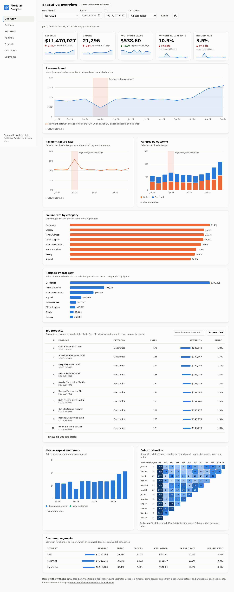
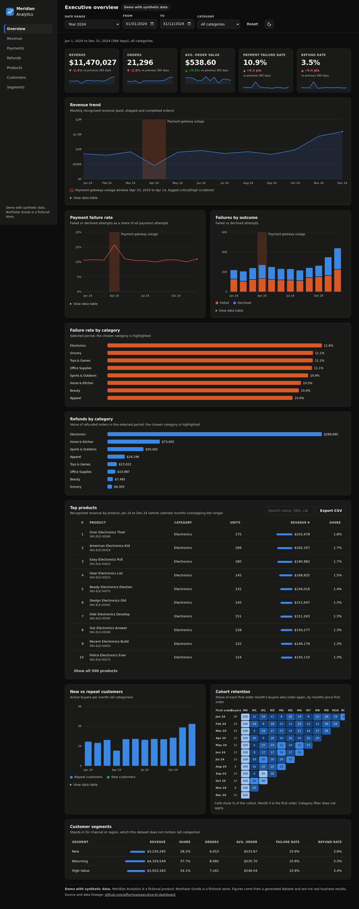

# Meridian Analytics: Executive BI Dashboard (demo)

[](https://github.com/alfiochoa/executive-bi-dashboard/actions/workflows/ci.yml)

**Live demo:** https://alfiochoa.github.io/executive-bi-dashboard/

> **Demo with synthetic data.** "Meridian Analytics" is a fictional product and
> "Northstar Goods" is a fictional store. All figures come from a generated
> dataset and are not real business results.

An executive overview a small-business owner can read in a minute: how much
money came in, how much leaked through failed payments and refunds, which
products carry the business, and whether customers come back. Static site
(vanilla JS + hand-rolled SVG charts, no framework, no build step); every filter
updates every widget in the browser.

| Light | Dark |
|---|---|
|  |  |

Phone width (390 px): [light](docs/mobile-light.png) · [dark](docs/mobile-dark.png)

## What is on the page

- **KPI tiles**: revenue, orders, average order value, payment failure rate, refund
  rate, each with a change vs the previous period of equal length and a sparkline.
- **Revenue trend** with the documented April 2024 payment-gateway outage
  highlighted (derived from the logged critical/high incident spike).
- **Payments**: failure-rate trend, failed vs declined attempts, failure rate by category.
- **Refunds by category** and a **top-products table** (sortable, searchable, CSV export).
- **Customers**: new vs repeat buyers per month and a cohort-retention heatmap.
- **Segments**: revenue, orders, order value, failure and refund rates by customer segment.
- Global **date range** and **category** filters, a dark/light toggle (saved in
  `localStorage`, guarded), skeleton loading states, keyboard-operable controls
  and charts (arrow keys read values), a "view data table" alternative under each
  time chart, print-friendly layout, and `prefers-reduced-motion` support.

## Data lineage

```
Northstar Goods synthetic CSVs  ->  scripts/build_snapshot.py  ->  data/snapshot.json  ->  app.js (browser)
(ai-business-data-assistant)         (pandas, read-only)           (~490 KB, 170 KB gzip)
```

The CSVs come from the companion project
[ai-business-data-assistant](https://github.com/alfiochoa/ai-business-data-assistant),
so numbers match it (CI checks April 2024 revenue of $450,473.13 and 269 of 1,708
payment attempts failing). Definitions: revenue counts `paid`, `shipped` and
`completed` orders; a failed payment is a `failed` or `declined` transaction;
refund rate is refunded orders over all orders. Each order is assigned to the
category with its largest line value so category totals add up. Rebuild with:

```bash
python scripts/build_snapshot.py ../ai-business-data-assistant/data
python3 -m http.server 8000   # then open http://localhost:8000
```

## What a client could get

The same layout can be pointed at a client's own data: the snapshot builder is
the only part that knows about the source, so a Postgres, BigQuery or Google
Sheets feed (or a scheduled export) can replace the CSVs. Metrics, filters and
dimensions are chosen with the client; what is possible depends on the data they
already collect.

## Limitations

- The dashboard reads a **pre-aggregated static snapshot**; it is not live and
  has no authentication, so do not publish real customer data this way.
- This dataset has no payment method, channel or region, so those views are not
  shown; customer segment stands in for them. "Failures by outcome" uses
  failed vs declined, the only reason-like field available.
- Product and customer views use whole calendar months that overlap the selected
  range. The cohort view ignores the category filter.
- Data covers 2023-01-01 to 2024-12-31, so "last 30 days" means the last 30 days of 2024.
- Charts are drawn in plain SVG for control and small size; very large datasets
  would call for server-side aggregation.

MIT-style demo; see repository for details.
